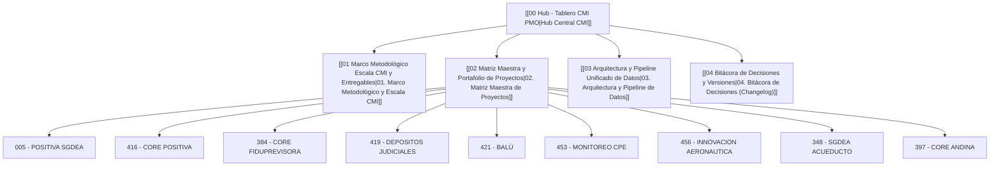

# 📊 Hub · Tablero de Control Estratégico y Táctico PMO (CMI)

> [!INFO] Resumen Ejecutivo
> Sistema central de supervisión ejecutiva y operativa de la **PMO** para el portafolio de proyectos estratégicos. Integra el seguimiento en vivo de entregables en **Azure DevOps**, la gobernanza contractual bajo la **Escala CMI oficial**, y la supervisión financiera (**EVM**, facturación, costos, márgenes, CPI e ICFF).

---

## 📌 Mapa de Navegación del Módulo CMI

---

## 🌐 Enlaces Oficiales del Sistema

- **Producción en Vivo (GitHub Pages):** [https://ivanpastor-debug.github.io/Tablero-CMI-PMO/](https://ivanpastor-debug.github.io/Tablero-CMI-PMO/)
- **Repositorio de Código Fuente:** `https://github.com/ivanpastor-debug/Tablero-CMI-PMO.git` (rama `main`)
- **Fecha de Corte Oficial:** `01-Oct-2026`

---

## 📂 Contenido de esta Carpeta

1. [[01 Marco Metodológico Escala CMI y Entregables]]: Reglas de medición por entregable, fórmula del Indicador Táctico y Estratégico, y excepciones metodológicas (453 Casos de Uso, 419 Archivo Local).
2. [[02 Matriz Maestra y Portafolio de Proyectos]]: Fichas de los 9 proyectos oficiales con volumetrías de Azure DevOps, frentes contractuales y datos financieros consolidados.
3. [[03 Arquitectura y Pipeline Unificado de Datos]]: Flujo de sincronización automatizado con `ACTUALIZAR_TODO.bat`, `ACTUALIZAR.py`, enriquecimiento CMI y carga local CORS.
4. [[04 Bitácora de Decisiones y Versiones]]: Registro cronológico de las 16 sesiones de evolución del tablero (Changelog completo).
