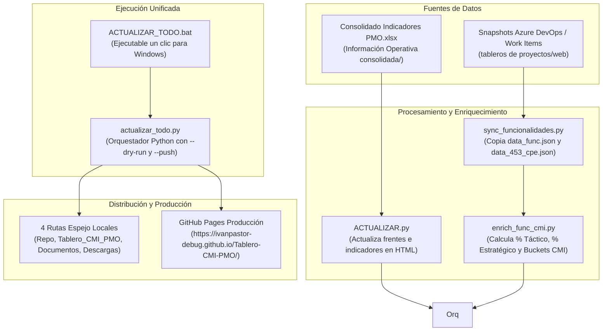

# 🏗️ Arquitectura de Datos y Pipeline Unificado de Actualización

> [!INFO] Propósito
> Describe la infraestructura de datos, el flujo de ingesta unificado y los scripts de automatización que mantienen sincronizado el Tablero CMI PMO.

---

## 1. Tubería Integral de Sincronización

---

## 2. Los 4 Pasos del Proceso Unificado

Cuando se ejecuta `ACTUALIZAR_TODO.bat` o `python actualizar_todo.py`:

1. **Paso 1 · Lectura de Excel PMO (`ACTUALIZAR.py`):**
   - Localiza el archivo `Consolidado Indicadores PMO*.xlsx` más reciente.
   - Actualiza la variable JavaScript `FR` para Acueducto 348.
   - Refresca los indicadores de 419, 348 y 456 en el HTML.
2. **Paso 2 · Sincronización de Azure DevOps (`sync_funcionalidades.py`):**
   - Copia `data_func.json`, carpeta `data_func/*.json` y `data_453_cpe.json` desde la carpeta web de tableros.
3. **Paso 3 · Enriquecimiento Oficial CMI (`enrich_func_cmi.py`):**
   - Recalcula los indicadores de cumplimiento CMI (táctico, estratégico, buckets 100%, 75%, 50%, 20%, 0%).
4. **Paso 4 · Sincronización en Rutas Espejo:**
   - Propaga el HTML actualizado a las 4 rutas espejo del sistema.
5. **Paso 5 · Despliegue Automático en Producción (Opcional):**
   - Si se confirma en pantalla o se pasa el argumento `--push`, ejecuta `git add .`, `commit` y `git push origin main`. En ~30 segundos GitHub Pages actualiza la web oficial.

---

## 3. Carga Híbrida en Línea (CORS Fallback para `file://`)

> [!TIP] Solución a Restricciones de Navegador
> Al abrir un archivo HTML con doble clic en Windows (`file:///...`), el navegador bloquea la lectura de archivos JSON locales por directivas de seguridad CORS.

En `index.html` se implementó la función inteligente `getJsonUrl(relPath)`:
- Si el protocolo es `http:` o `https:` (GitHub Pages): Descarga local asíncrona rápida (`data_func/384.json`).
- Si el protocolo es `file:` (Doble clic local): Descarga automáticamente desde `https://ivanpastor-debug.github.io/Tablero-CMI-PMO/` aprovechando el encabezado CORS abierto `Access-Control-Allow-Origin: *`.
- **Resultado:** El usuario puede interactuar con el árbol jerárquico de Azure DevOps tanto en la web como en su visor local sin bloqueos.
