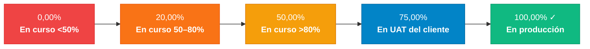
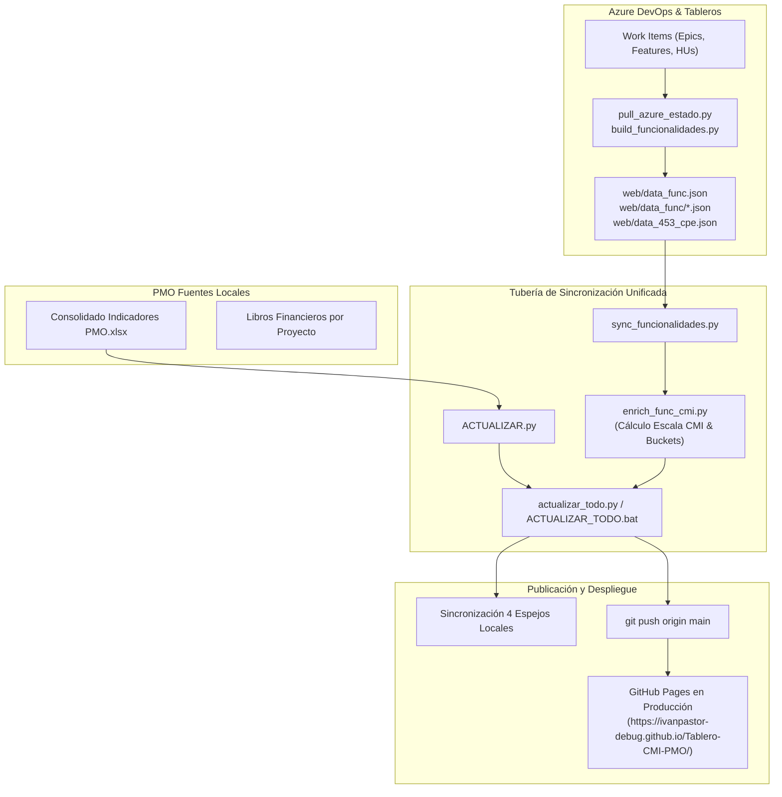

# 📊 Tablero de Control Estratégico y Táctico PMO (CMI)

> [!INFO] Propósito Ejecutivo
> Sistema central de supervisión ejecutiva y táctica de la **PMO** para el seguimiento integral de los proyectos estratégicos institucionales. Integra la dimensión **operativa en tiempo real** (conectada a Azure DevOps), la gobernanza de **entregables contractuales** bajo la Escala CMI oficial, y la dimensión **financiera corporativa** (EVM, valor contractual, facturación con/sin IVA, recaudo, CPI e ICFF).

---

## 🧭 1. Resumen Ejecutivo y Enlaces de Producción

| Parámetro | Detalle Oficial |
| :--- | :--- |
| **Hosting y Despliegue** | **GitHub Pages** (100% gratuito, disponibilidad continua, sin consumo de cuota mensual) |
| **URL Pública en Producción** | [https://ivanpastor-debug.github.io/Tablero-CMI-PMO/](https://ivanpastor-debug.github.io/Tablero-CMI-PMO/) |
| **Repositorio Remoto** | `https://github.com/ivanpastor-debug/Tablero-CMI-PMO.git` (rama `main`) |
| **Fecha de Corte Oficial** | `01-Oct-2026` |
| **Punto de Entrada Web** | `index.html` (servido directamente con `.nojekyll` y CORS habilitado) |
| **Gobernanza de Medición** | Medición sobre **Épicas (Epics / Frentes)** en Azure DevOps, con excepciones oficiales para 453 (**Casos de Uso**) y 419 (**Archivo Local**). |

> [!NOTE] Nota sobre Vercel
> La cuenta gratuita de Vercel agotó el 100% de la cuota mensual del plan Hobby. El tablero fue migrado permanentemente a **GitHub Pages**, garantizando alta disponibilidad sin costos ni interrupciones.

---

## 🎯 2. Marco Metodológico: Escala CMI por Entregable PMO

El Cuadro de Mando Integral (CMI) evalúa el avance operativo de los proyectos transformando el estado de cada entregable en un porcentaje estandarizado bajo una **escala de 5 niveles**:



### 📐 Fórmulas Oficiales de Cálculo

1. **Indicador Táctico (% de Avance por Funcionalidad / Entregable):**
   Promedio aritmético del valor asignado a cada entregable $i$ según la Escala CMI:
   $$\text{Indicador Táctico} = \frac{1}{N} \sum_{i=1}^{N} \text{Escala}(E_i)$$
   Donde $\text{Escala}(E_i) \in \{0.00, 0.20, 0.50, 0.75, 1.00\}$.

2. **Indicador Estratégico (% de Entregables al 100% en Producción):**
   Razón de entregables formalmente aceptados o puestos en producción sobre el total de entregables:
   $$\text{Indicador Estratégico} = \frac{\text{Entregables al 100\% (en Producción)}}{\text{Total de Entregables Contractuales}} = \frac{D}{N}$$

3. **Criterios de Ponderación:**
   - **`100,00%` ✓:** En producción ($\text{pct} \ge 0.999$).
   - **`75,00%`:** En pruebas UAT del cliente.
   - **`50,00%`:** En curso $>80\%$ ($\text{pct} > 0.80$).
   - **`20,00%`:** En curso $50\text{--}80\%$ ($\text{pct} \ge 0.50$).
   - **`0,00%`:** En curso $<50\%$ ($\text{pct} < 0.50$).

---

## 📋 3. Matriz Maestra del Portafolio de Proyectos

A continuación se resume el estado oficial y homologado de todos los proyectos del portafolio:

| Código PMO | Nombre Oficial del Proyecto | Cliente / Entidad | Unidad de Medición | Indicador Táctico | Indicador Estratégico | Detalle de Entregables | Valor Contrato (Sin IVA) |
| :---: | :--- | :--- | :---: | :---: | :---: | :--- | :---: |
| **005** | `005 - PROYECTO POSITIVA SGDEA 2026 - 3T` | Función Pública / MinTrabajo | **18 Épicas** | **50,56%** | **38,89%** | 7 de 18 Épicas (77 Func. / 43 prod) | $3.986 M |
| **416 / POS** | `416 - PROYECTO DE DESARROLLO Y SOPORTE CORE POSITIVA` | Positiva Compañía de Seguros | **20 Épicas** | **21,85%** | **0,00%** | 0 de 20 Épicas (87 Func. / 6 prod) | $6.067 M |
| ↳ *355* | *Subproyecto 355 · Positiva Core* | Positiva Seguros (Sub 355) | 18 Épicas | 21,05% | 0,00% | 0 de 18 Épicas (80 Func. / 6 prod) | *(Consolidado en 416)* |
| ↳ *416* | *Subproyecto 416 · Evolutivos* | Positiva Seguros (Sub 416) | 2 Épicas / Ramos | 29,00% | 0,00% | 0 de 2 Épicas (7 Func. / 0 prod) | *(Consolidado en 416)* |
| **384** | `384 - PROYECTO CORE FIDUPREVISORA` | Fiduprevisora S.A. | **32 Épicas** | **42,19%** | **3,12%** | 1 de 32 Épicas (543 Func. / 155 prod) | $21.017 M |
| **419** | `419- DEPOSITOS JUDICIALES` | Banco Agrario / Rama Judicial | **466 Func.** *(Local)* | **12,01%** | **26,82%** | 125 de 466 Certificadas (168 Func. Azure) | $28.493 M |
| **421** | `421 - PROYECTO BALÚ` | Fiduprevisora · Afiliaciones | **2 Frentes** | **35,00%** | **0,00%** | 0 de 2 Frentes (66 Func. / 19 prod) | $100.945 M |
| **453** | `453 - PROYECTO MONITOREO DE EQUIPOS CPE 2026` | MinEducación · CPE | **45 Casos de Uso** | **30,30%** | **8,89%** | 4 de 45 CUs en estado 19. Entregado | *Por definir* |
| **456** | `456 - PROYECTO INNOVACION AEREONAUTICA CIVIL` | Aeronáutica Civil · Lab Innovación | **6 Hitos Contractuales** | **24,00%** | **16,67%** | 1 de 6 Hitos (Fase I Entregable 1) | $1.582 M |
| **348** | `348 - PROYECTO SGDEA ACUEDUCTO` | EAAB (Acueducto Bogotá) | **10 Épicas** | **25,29%** | **10,00%** | 1 de 10 Épicas (95 Func. / 15 prod) | $11.031 M |
| **397** | `397 - PROYECTO CORE ANDINA` | Andina Seguros (Colfondos) | **57 Épicas** | **97,06%** | **91,18%** | 52 de 57 Épicas (233 Func. / 228 prod) | $1.450 M |

---

## 🏗️ 4. Arquitectura del Sistema y Tubería de Datos

El sistema sincroniza dos mundos complementarios: el mundo de los libros Excel (financiero/contractual) y el mundo vivo de Azure DevOps (técnico/operativo).



### ⚡ Carga Inteligente Híbrida (CORS Fallback)
Para resolver la restricción de navegadores que bloquean `fetch()` bajo el protocolo local `file://`:
- **En Producción (GitHub Pages):** Descarga relativa instantánea (`fetch("data_func/384.json")`).
- **En Local (`file:///...`):** Mediante la función `getJsonUrl()`, el tablero descarga los JSON vivos directamente desde el dominio público de GitHub Pages con encabezado CORS `Access-Control-Allow-Origin: *`. El usuario puede abrir el archivo HTML con doble clic y ver el árbol de Azure DevOps en vivo sin necesidad de levantar servidores locales.

---

## ⚙️ 5. Guía de Operación y Automatización

> [!IMPORTANT] Regla Estricta de Compatibilidad
> El script de automatización `ACTUALIZAR.py` busca la declaración de datos mediante la expresión regular:
> `FR_PATTERN = re.compile(r"const FR=(\{[\s\S]*?\});\s*const BOOK416=")`
> **Bajo ninguna circunstancia se debe alterar la estructura de esa línea en el HTML.**

### 🚀 Actualización en Un Solo Clic

Para actualizar todo el sistema (financiero, operativo, Épicas de Azure y espejos):

1. **Vía Archivo por Lotes (Doble Clic):**
   Ejecutar `ACTUALIZAR_TODO.bat` ubicado en:
   - `C:\Users\Usuario1\Documents\PMO INDICADORES\CMI\ACTUALIZAR_TODO.bat`
   - O en `c:\Users\Usuario1\Indicadores estra y tac\ACTUALIZAR_TODO.bat`

2. **Vía Consola (PowerShell / CMD):**
   ```powershell
   # Actualización completa con publicación automática a GitHub Pages
   python actualizar_todo.py --push

   # Validación sin modificar archivos (modo seguro)
   python actualizar_todo.py --dry-run
   ```

3. **Ejecución del script tradicional:**
   ```powershell
   # Valida la integridad del consolidado y el HTML
   python "C:\Users\Usuario1\Documents\PMO INDICADORES\CMI\ACTUALIZAR.py" --dry-run

   # Si se ejecuta sin dry-run, sincroniza los 4 espejos y corre sync_funcionalidades automáticamente
   python "C:\Users\Usuario1\Documents\PMO INDICADORES\CMI\ACTUALIZAR.py"
   ```

---

## 📂 6. Archivos y Rutas Espejo del Tablero

Cualquier cambio se propaga y sincroniza estrictamente en las **4 rutas espejo**:

1. `c:\Users\Usuario1\Indicadores estra y tac\index.html` *(Raíz web para GitHub Pages)*.
2. `c:\Users\Usuario1\Indicadores estra y tac\Tablero_CMI_PMO.html` *(Copia local de trabajo)*.
3. `C:\Users\Usuario1\Documents\PMO INDICADORES\CMI\Tablero_CMI_PMO.html` *(Copia maestra de usuario)*.
4. `C:\Users\Usuario1\Downloads\Tablero_CMI_PMO.html` *(Copia de consulta rápida)*.

---

## 📜 7. Bitácora Histórica de Decisiones y Versiones

> [!NOTE] Registro Cronológico de Evolución
> 
> * **16-Oct-2026 (Sección 16) · Alineación y Automatización Integral:**
>   - Creación del orquestador unificado `actualizar_todo.py` y el ejecutable `ACTUALIZAR_TODO.bat`.
>   - Integración directa en `ACTUALIZAR.py` para sincronizar las 4 rutas espejo y llamar a `sync_funcionalidades.py`.
>   - Incorporación de `getJsonUrl` con soporte CORS en `index.html` para habilitar lectura del árbol de Azure bajo `file://`.
> * **16-Oct-2026 (Sección 15) · Estandarización de Nombres Oficiales en Todo el Tablero:**
>   - Homologación global de los nombres de proyectos (005, 416, 384, 419, 421, 453, 456, 348, 397).
>   - Actualización en chips (`#pchips`), tarjetas (`#sem-op`), tabla (`semName`), flujo de caja (`#flow`), gráfica de costos (`#c-costport`) y callouts (`PROJ_CALLOUT_META`).
>   - Control anti-duplicación para evitar códigos repetidos en tarjetas.
> * **16-Oct-2026 (Sección 14) · Ajustes en 453 (CPE) y 419 (Depósitos):**
>   - 453 renombrado a `453 - PROYECTO MONITOREO DE EQUIPOS CPE 2026`. Se retiró la tabla estática `#cpe-cu` y se depuraron filtros de focos, dejando únicamente el conmutador metodológico (*Por ejecución* vs *Por compromiso*).
>   - 419 renombrado a `419- DEPOSITOS JUDICIALES`. Reubicación de la gráfica de certificaciones `#c-419` inmediatamente después del desglose de Azure DevOps.
> * **16-Oct-2026 (Sección 13) · Medición por Épicas del Portafolio y Limpieza Operativa:**
>   - Gobernanza oficial de entregables CMI sobre Épicas en 005, POS, 384, 421, 348 y 397.
>   - Excepción oficial de 419: preserva indicadores del archivo local PMO (125 / 466).
>   - Retiro del panel estático *"Escala CMI por frente"* (`#fr-list`), preservando de forma estricta las dos columnas contractuales en 456 (Aeronáutica Civil).
> * **15-Oct-2026 (Sección 12) · Estandarización Visual Ejecutiva:**
>   - Generalización del contenedor callout estilizado (`PROJ_CALLOUT_META`) con insignia dinámica (`getBadgeTag`) y bloque financiero enriquecido (`finMini`).
> * **15-Oct-2026 (Sección 11) · Homologación de 397 (Colfondos Core · Andina Seguros):**
>   - Aclaración de cliente oficial: Andina Seguros. Medición CMI sobre 57 Épicas (52 en prod · 91,18% est, 97,06% tác).
> * **14-Oct-2026 (Sección 10) · Homologación de Casos de Uso (CU) en 453:**
>   - Medición exclusiva sobre 45 Casos de Uso (4 entregados en estado 19 · 8,89% est, 30,30% tác).
> * **14-Oct-2026 (Sección 9) · Alimentación Dinámica de Indicadores CMI desde Azure DevOps:**
>   - Creación de `enrich_func_cmi.py` y cálculo de buckets PMO por funcionalidad.
> * **14-Oct-2026 (Sección 8) · Integración del Desglose Funcional & HUs:**
>   - Ingesta de árboles jerárquicos vivos: Frente → Funcionalidad → Historia de Usuario.
> * **07-Oct-2026 (Sección 7) · Integración Financiera Oficial:**
>   - Incorporación de libros oficiales de 348 (Acueducto) y 456 (Aeronáutica) a la lista `FIN`.
>   - Migración permanente de hosting a GitHub Pages.

---

## 🔗 Referencias Cruzadas en Obsidian
- [[00 Hub - Salud de los Proyectos]]
- [[01 Marco Metodológico y Catálogo de Indicadores]]
- [[419 - Depósitos Judiciales y Rama Judicial]]
- [[421 - Balú]]
- [[08 Medicion de Delta Diario y WIP por Etapas y Areas]]
